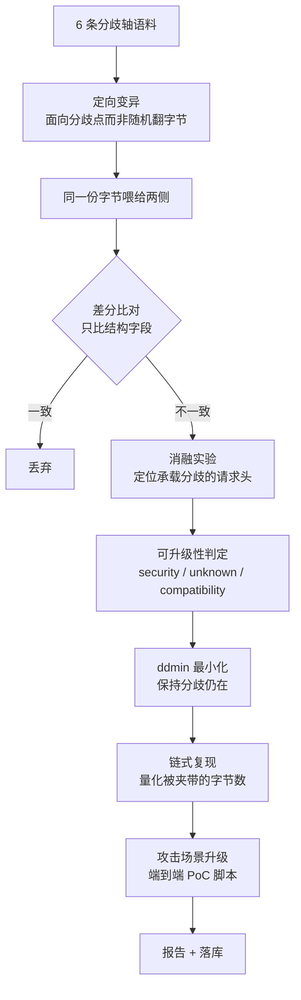

# CED — 产品耦合误差检测

> 客户把产品交给我们，我们找出它们在**串联处的耦合误差**。

单独看 nginx 没问题，单独看 gunicorn 没问题，但 `nginx + gunicorn` 就有 desync。
**漏洞不在组件里，在组件之间的语义缝隙里。**

传统 SCA 只看依赖的版本号，对 fork、自编译副本、被 vendor 进大项目的代码完全失效；
本工具不看版本号，看的是**两个实现读同一段字节时，谁读出了不同的边界**。

---

## 核心公式

$$\text{漏洞} \iff \text{语义分歧} \;\wedge\; \text{分歧点攻击者可控} \;\wedge\; \text{存在安全后果}$$

中间那一项是全部难点。本工具**不用规则猜**，而是用**消融实验**机械地定位承载者：

> 逐条移除请求头，重新把同一段字节喂给两侧 —— 如果分歧消失了，
> 说明这个分歧就是由那条请求头承载的；而请求头是攻击者可以直接发送的。
>
> 这就是「分歧由攻击者可直接发送的字节承载」的可复算证据，而不是一个形容词。
> 消融定位的是承载者，不等于证明可实际利用 —— `security` 的含义是「结构性前提成立」，
> 最终结论以实机复现为准。

第一项在**捕获 / 手动检测**这条路上还多一道前置检查：请求行与请求头本来就全是攻击者
直接发送的，光有"可控"这一条不足以说明任何问题。所以两侧观测**只差写法**（ASCII 字母
大小写、参数书写顺序）时，判定停在 `unknown`（需人工复核）—— 同一段内容换个写法，
不是"被读成了不同的东西"。这道检查把一次真实浏览的数字从 83/128 条安全级降到 27/128：
`remoteStorage` / `remotestorage` 这种差异满屏都是，没有区分度。

## 结论分两层：类别 + 危险等级

一个"安全级 N"的数字会被读成"N 个漏洞"，所以结论分两层报：

- **类别**回答"算不算安全问题"：`security`（结构性前提成立）/ `unknown`（疑点）/
  `compatibility`（仅诊断字段）。
- **危险等级**回答"多严重、证据多硬"：**严重 / 高 / 中 / 低 / 信息**。

等级 = **类型上限**（领域知识：分帧边界错位能直接夹带请求 → 上限"高"；编码口径差异
最多是过滤器绕过 → 上限"中"）+ **证据强度**：

| 证据 | 等级 |
|---|---|
| 实机测量到错位（前置转发 / 探针实测，非模型推演） | **严重** |
| 有量化错位（两侧确实读成不同的资源 / 参数 / 站） | 类型上限（高 / 中 / 低） |
| 量化不出来（含真实产品、本机算不了） | 降一档 |
| 量化出来但两侧其实一致 | 降两档 |
| 仅写法差异 / 接受性分歧 / 定位不到承载者 | 低 |
| 仅诊断字段不同 | 信息 |

> 「结构性前提成立」永远只到"高"。**只有实机测量能把等级顶到"严重"** ——
> 这条线是刻意的：模型推演再漂亮也不该冒充实测。

## 每条漏洞都附一份「修复形态」

光说"建议规范化路径"没用 —— 说不出**到底是哪几个字节**在制造歧义。所以每条分歧都会
额外算一份**修复形态**：把承载歧义的那段字节重写成**基准实现的规范形态**，再和**原始
输入逐行对照**（页面上左右两栏，报告里一段 `diff`）。被改掉的那几行就是答案，可以直接
贴回代理规则或 fuzzer 里。

```
- /static/../admin
+ /admin
```

`Content-Length` 与 `Transfer-Encoding` 并存这类，修复口径是**直接 400 拒绝**：拒绝
会明确标出来，规范形态仍然给出，用来看清歧义在哪。改字节消不掉的（纯策略差异）
会如实写"无需改写字节 —— 两侧策略不同"，绝不编一个假的修复方案。

**对照表只在字节真的变了时才画。** 没变的两栏一模一样，那不是对照、是噪声 ——
看着像"修复没生效"，其实这条根本没有可改的字节。于是分三种情形说话：

- 字节变了 → 给逐行对照（左 = 原始输入，右 = 规范形态）；
- 字节没变，但内核仍有话说（例如请求体的裸 LF 只能在实现侧改，`Content-Length: abc`
  只能拒绝）→ 照样列出改动点，只是不画那张表；
- 两侧策略不同、字节无从下手 → 一句"无需改写字节（策略差异）"把原因说清，不留空白。

**它在页面上有自己的位置：一张独立的卡，排在最显眼的地方，而且和模型无关。**

| 入口 | 独立块的位置 | 给谁 |
|---|---|---|
| 手动检测 | 「模型解读」和「实验流程」之间 | 这次检测的**每条**发现 |
| 流量接入 | 「模型解读」和记录列表之间 | 当前**选中的那条**记录 |
| 产品实测 | 「运行状态」和「发现与研判」之间 | 当前**选中的那条**发现 |
| 外部工具结果（nuclei / Burp / HAR / curl / URL 清单） | 同手动检测 | 已证实的条目 |

为什么单起一块：它是**确定性内核**算出来的（各领域的改写规则），模型没配、没勾、
超时、报错，都跟它无关 —— 以前它寄生在「模型解读」卡片里，解读没出来就一起消失，
勾了解读时整张实验报告还会自动收起，东西在里面等于没有。现在它默认展开、
不参与"有解读就收起"那套逻辑。没有可改写的字节时会明确写出原因，
不会留一片空白让人分不清"没有"和"坏了"。

疑点（没升级的那些）也照给 —— 没升级只说明证据不足以定级，不代表这份输入不用改。

---

## 30 秒跑起来

**只需要 Python 3.11+。零第三方依赖，不需要 Docker，不需要联网。**

```bash
git clone https://github.com/weekendsunday/CED.git
cd CED

python main.py                    # 启动网页界面（推荐，点鼠标就行）
```

在 VSCode / PyCharm 里直接点运行按钮也行 —— 运行的就是 `main.py`。

其它入口：

```bash
python main.py --check                 # 跑自检（测试 + 已知案例反验证）
python main.py --probe                 # 同时起探针服务（接真实产品用）
python -m ced regression               # 已知案例反验证
python -m ced probe 请求文件            # 探测一份原始字节文件
python -m ced probe 请求文件 --domain url-norm   # 指定领域（默认分帧；共 5 个）
python -m ced capture --port 18081     # 自动捕获：浏览器/系统代理指向它，请求自动进差分
python -m ced scan --mode axis --limit 60 --out report.md --db ced.db
```
HTTPS 捕获证书支持 Python 3.13 的严格 X.509 校验：新 CA 带 SKI，叶子带 AKI；缺 AKI 的旧叶子
在重新加载时补签。已有 CA 本身缺 SKI 时需显式更换，升级步骤见
[`docs/部署运行说明.md`](docs/部署运行说明.md#https-证书升级与既有-ca)；代码不会擅自替换用户 CA 或修改系统信任。


### 网页界面做什么

| 面板 | 用途 |
|---|---|
| **手动检测**（侧栏第一项，默认面板） | 把东西粘/拖进来，或从「**载入示例**」里直接挑一个 → **它自己判断这是什么**（HTTP 请求原始字节 / nuclei / Burp / HAR / curl / URL 清单）→ **自己调用对应工具**跑完整链路：扇出 5 个领域 → 逐对差分 → 消融判定 → 升级 PoC → 出报告。要测实时流量就切「**流量接入**」那一项（本机代理 + 一行参数摘要，「捕获设置…」小窗改完可「存为默认」写回设置页；要解 HTTPS 明文，面板上「**HTTPS 解密证书**」一行有一键导入本机信任库 / 撤销 / 下载证书（状态是真的查出来的，不用自己敲命令），还有「**导入已有 CA…**」——单位已有一张被授权的 CA 时，把它的证书与私钥导进来全队共用（PEM 与 .p12 都认，证书与私钥同在一份文件里也行；导入只在本机解析，换 CA 后旧的叶子证书会一起清掉），以及「**清理已签发证书**」（按域名签的叶子证书攒多了一键清，下个请求自动重签）；勾了「使用模型解读」则解读面板摆在请求列表之上，每条请求的最强一条发现自动补一段模型转述）；列表里每条请求行尾可**单独删掉**、列表工具栏有「**清空记录**」（删的只是网页这份列表 —— 开了「记录到文件」时 JSONL 台账里的原始记录一条都不动，证据不因删列表而消失；**一次「开始 → 停止」算一次会话**：侧栏按会话归档（正在跑的那次标「进行中」，停下后留在侧栏），点它就把中栏切成**那一次的快照**（顶部一行提示 + 「回到当前」），记录、证据、解读与 PoC 都还点得开 —— 内存里留最近 3 次已结束的会话，更老的翻 JSONL）。中栏排序＝看东西的顺序：**模型解读（若勾了）→ 实验流程（可折叠）→ 实验报告（可折叠）**；**一旦用了模型解读，解读升为主内容、流程与报告自动收起**，先看结论再展开过程 |
| **产品实测**（侧栏一项） | 把**真实产品接进来**喂一遍：选跑法（**接我的产品** / **只跑内置基准**）→ 填三项（产品入口地址 / 记录员地址 / 记录员的读法）→ **检查连通性**（问身份 → 清空视角 → 试发一条，三盏绿灯才允许开跑）→ 开始。结果页顶部固定三行说清「这次是谁跟谁比」（A 侧是谁与地址、B 侧是谁与几个、几条读法不一致与最严重档位），**每条发现旁标「实测 / 推演」**；没有真实产品参与时明写「本次没有真实产品参与 —— 下面是疑点，不是耦合结论」。高级折叠里可**导入 / 导出连线设置**（文件选择，不用手打路径） |
| **设置**（侧栏左下角按钮 → 小窗） | 所有可配置项集中一处：**模型 API 接入**（base_url / model / key / 超时 / 温度 / max_tokens）、自动捕获默认值、检测默认值（**含「使用模型解读」开关**：手动检测与流量接入**共用一个开关**，三处勾选框永远同步，见下文「解读层」）、**产品实测默认值**（领域 / 怎么比 / 喂多少条写法 / 随机种子 —— 保存后会预填到「产品实测」面板上那几个控件）、输出路径。保存即生效（服务启动时也会自动加载），**捕获的默认值会预填到「捕获设置…」小窗、起捕获时按它回落**（不是摆设）；密钥只回显掩码、绝不入库。按钮下方常驻一行模型状态（可用时显示模型名），免得勾了「使用模型解读」才发现没配 |
| **自检与案例库**（侧栏一项） | 一键跑已知案例反验证（47/47）；内置案例库（47 个）点开看两侧观测与判定 |

> 布局是「**左侧栏 + 中栏**」：左栏自上而下是**品牌 → 四个功能键**（手动检测 / 流量接入 / 产品实测 / 自检与案例库）、**检测历史**（本次会话内**每次手动检测**与**每次流量接入**各一条，按日期归档，点一条回到那次结果；手动检测那一条回到那次发现，流量接入那一条回到那次接入的**记录与证据**，行尾悬停出删除键。**逐条请求**不往这里抄 —— 它们常驻在「流量接入」中栏那份列表里，抄一份等于同一批记录摆两处、还各有删除键）、**左下角的「设置」**与模型状态；中栏是当前功能的产出，手动检测下依次是输入卡、模型解读、实验流程、实验报告。切换功能会把面板写进 URL hash，浏览器前进 / 后退可用。
>
> 样式与脚本拆成 `app.css` + `app.js` 两个静态资源（由 `server.py` 按白名单直出，仍然**零第三方依赖**）；主题为浅色单一配色（Apple 官网式：纯白底 + 分区灰 + 发丝边 + 药丸按钮），全部令牌集中在 `app.css` 顶部的 `:root`。

### 产品实测：怎么把真实产品接进来

**这一版是原地改造**：探针只服务「产品实测」这一个面板；手动检测与流量接入**保持现在的口径**
（只跟内置参照实现比，不动）。判定内核（比对 / 消融 / 定级 / 修复形态）**一行没动**。

引导式入口就四步，照着做就行：

1. **选跑法**：`接我的产品`（真实产品发一条、观测一条 → 结果带「实测」）或 `只跑内置基准`
   （进程内离线推演，不连任何东西 —— 用来演示与回归）；
2. **填三项**（选「接产品」才出现）：**产品入口地址**（客户端本来会连的那个 `host:port`）、
   **记录员地址**（挂在产品**后面**那台探针的控制口）、**记录员的读法**（探针启动时用的 `--policy`）；
3. **点「检查连通性」**：三步各自给一盏灯 —— ①问记录员身份（它自报领域 + 读法，**对不上就是红灯**）
   ②清空已有记录 ③试发一条看它收不收得到；**三盏绿灯才允许开跑**；
4. **开始实测**。结果页顶部固定三行自证：**A 侧（实测）是谁 / 在哪个地址**、
   **B 侧（离线）是谁 / 一共几个**、**读法不一致几条 + 最严重档位**。

**每条发现旁标证据来路**：`实测`（有一侧是真实产品）还是 `推演`（两侧都是内置参照实现，离线算的）。
**没有真实产品参与时，结果页会明写「本次没有真实产品参与 —— 下面是疑点，不是耦合结论」**，
不让一份离线推演看着像实机结论。

**跑得快**：按「实现 + 同一条字节」做了一层**一次运行内**的观测缓存（每次运行新建、跑完就丢，
绝不挂在长驻的 Evaluator 上 —— 否则跨请求复用旧观测、内存还会涨）；探针也改成**收全即处理**
（按 HTTP 消息边界判断；判不出来就如实等超时/EOF，**绝不合成视角**）。
接真实产品喂满 60 条：从十几分钟降到几十秒（本机用「吃不下客户端半关闭」的替身前置模拟真实 nginx，实测 60 条约 15 秒）。

**静态拦错**：连线设置里字段写错、产品清单为空、id 缺失、`runner` 说不出地址、领域与记录员自报的不一致 ——
一律**起跑前当场说人话**，不会跑完 0 条分歧还不吭声。本机没装 PyYAML 时读 `.yaml` 也会得到人话
（仓库里的示例另备了 `.json`；无 Docker 时的替身链路是 `ced/topologies/standin-front.json`）。

无 Docker 也能验证「接产品」这条路：

```bash
# ① 起记录员（探针）—— 它自报领域与读法，供「检查连通性」核对
python -m ced serve --policy ref-cl-first --data-port 8800 --api-port 8801

# ② 起替身前置（模拟客户前置；无 Docker 时的替身）
python ced/tests/fixtures/standin_front.py pass 18080 8800

# ③ 网页里「产品实测 → 接我的产品」填 127.0.0.1:18080 / 127.0.0.1:8801 / ref-cl-first，
#    点「检查连通性」再三盏绿灯开跑；或直接走命令行：
python -m ced scan --topology ced/topologies/standin-front.json --mode axis --limit 60 --out results/standin.md
```

任务与事件流都用标准库手写：后台线程跑、`text/event-stream` 推事件（扫描进度、以及检测的**阶段 / 报告行 / 发现**都走这条通道），不引任何前端框架或 WebSocket 库。

---

## 实测效果

| 指标 | 数字 |
|---|---|
| 领域 | **5 个**：`enc-norm` · `host-norm` · `http1-framing` · `query-norm` · `url-norm` |
| 参照实现 / 定向对照 | 10+9+9+11+12 = **51 个参照实现**，10+8+8+10+11 = **47 对定向对照** |
| 能指出的漏洞类别 | **6 类**：请求走私 · 鉴权绕过/路径穿越 · 虚拟主机绕过/缓存投毒 · 参数污染 · 过滤器绕过 |
| 实测（每领域 40 用例） | 分帧 13/11 · 路径 82/68 · Host 90/83 · 查询串 100/96 · 编码 82/52（分歧 / 其中安全级） |
| 真实 Docker 链路 | 实机跑通两个真实产品：`nginx:1.25.5`（第一档：nginx → 探针）与 `nginx → gunicorn` 第二档。**2026-10-11 实测重跑**：第二档 13 用例 / 前置拒绝 126 条 / 33 分歧 / 2 安全级；26 条 security 级最小样本被真实 nginx **全部 400/501 拒绝、零转发**（第一档无走私面）；实测到 nginx 真实行为三例：`TE: xchunked` → **501**、chunked 体被重定帧为 CL 再转发（79B 模型账 vs 114B 实转）、客户端半关闭且体在途时**取消转发**。PoC 支持 `--chain` 实机取证：`verified: real-chain` 断言（`984d5316` 实机 PASS）。明细见 `docker/README.md` 实测记录 |
| 报告可读性 | 按「同一对实现 + 同一分歧类型」归并：分帧 13→**3** · 路径 82→**14** · Host 90→**6** · 查询串 100→**15** · 编码 82→**9**（发现 → 类；冗余最高 **15.0×**） |
| 已知案例反验证 | **47/47 通过**（期望值来自 RFC / 公开先例；其中 **9 条**分帧案例另附真实产品实机观测 `real_obs`——nginx:1.25.5 与 nginx→gunicorn 两档实采，模型内反验证与实机观测分列、不混口径，见 `python -m ced regression` 输出） |
| 自动化测试 | **314 个测试方法**（静态计数；实际执行结果见 `python main.py --check`；分组明细见 `ced/tests/`） |
| 代码量 | 源码 81 文件 15553 行；测试 19 文件 5980 行（测试方法 314 个，静态计数；实跑结果见 `python main.py --check`）；前端 3 文件 4048 行（`index.html` / `app.css` / `app.js`）|
| 第三方依赖 | **0** —— 连模型调用（`urllib`）与前端事件流（手写 SSE）都是标准库 |

> 表中领域 / 实现数 / 案例数 / 代码量等规模数字由 `python -m ced stats`
> 现场从代码生成 —— 文档里不手写数字，改了代码就重跑这条命令。

真实产出的一条发现（连同它自动生成的 PoC 脚本）：

```
最小复现样本：POST / HTTP/1.1\r\nContent-Length: 0000003\r\n\r\nabc
链式复现：若 ref-cl-first → ref-lenient-cl 串联：前置转发 44 字节，
          后端只消费 0 字节 → 44 字节被夹带，将成为下一条请求的开头
PoC 脚本：python results/pocs/poc_8b2611d2.py
          → 前置转发 39 字节 / 后端消费 0 字节 / 被夹带 39 字节
          → 断言 PASS
```

---

## 大模型在这里做什么（以及不做什么）

**大模型只在结论出来之后做解读；「往哪里搜」和「是不是漏洞」全部由确定性内核决定。**

模型在本项目里只有**一个**位置：**解读层（后置、可选、默认关）**。判定已经由内核定完
之后，把已经定好的证据翻译成人话，给报告**加**一栏「模型解读（**非判定**）」。

| | 大模型 | 确定性内核 |
|---|---|---|
| 能做 | 把一条已定级的发现讲成人话：真实拓扑下意味着什么 / 可能属于哪类 CWE / 该怎么修 | 定语料 → 差分比对 → 消融实验 → 判定 → 最小化 → 链路量化 → PoC |
| 做不到 | 产出判定，也影响不了搜索方向 —— `Interpretation` 里**没有任何判定字段**（没有 level / cwe / verdict） | — |

```bash
python -m ced web                     # 检测页 / 设置里勾「使用模型解读」即可
```

### 解读层：判定出来之后，让模型把证据讲成人话（可选，默认关）

内核那句话是写给机器看的 ——「同一对实现的 `Content-Length` 解析在 `cl-first` 与
`lenient-cl` 上取值不同」，外行读不懂。解读层就补这一段：**判定之后**、出报告之前，
让模型把这条已定的发现翻译成「在真实拓扑下意味着什么 / 可能属于哪类 CWE / 该怎么修」。
它只影响"怎么读"，不碰"搜什么"，更不碰"是不是漏洞"。

| | 解读层（`interpret`） |
|---|---|
| 时机 | 内核**之后**（`judge` 出完级才调） |
| 输出 | `impact`（后果）· `cwe_hint`（CWE 建议）· `fix`（修复建议） |
| 进结果的方式 | 只往发现上**挂一段文字**，报告原文案一行不动 |
| 失败时 | 回落内核原文案，报告照出，`ok=False` |

为什么解读层不可能污染判定 —— 三条硬约束（都写在 `ced/assist/interpret.py` 顶部）：

1. **时机**：只在 `judge` 出完级之后调用，它看不到也改不了级别；
2. **形状**：`Interpretation` 里**没有任何判定字段**（没有 `level`、没有 `verdict`）；
   只认 `INTERPRET_KEYS = ("impact", "cwe_hint", "fix")` 三个键，模型自作主张塞进来的
   `"level": "security"`、`"cwe": "CWE-444"` 之类在解析时被**直接丢弃**，不进任何结构；
3. **降级**：没配模型 / 调用失败 / 输出不是 JSON —— 一律返回 `ok=False`，
   调用方保留内核原文案，绝不让"模型没答上来"改变报告。

每段文字都有长度上限（`impact` / `fix` 各 400 字、`cwe_hint` 160 字），防止一段话
把报告刷爆；提示词**刻意不喂原始字节**，只喂判定结果与证据文本 —— 免得模型越过解读
去自己重做一遍差分。

代价是它要调模型、有等待，所以**默认关**：设置面板「使用模型解读」、检测页那一勾、
或「捕获参数…」里的同一勾才走这一层 —— **三处说的是同一件事，永远同步显示同一个
状态**（以前各读各的，改了一处另两处不动，看着像没生效）；模型没配置好时检测页与
捕获页那两个勾选框自动置灰，设置页那个仍可点（它就是"填完模型顺手定默认"的地方）。

那一栏在页面上有明确的主次关系：**勾了解读，解读就升为主内容摆在最前** ——
手动检测下实验流程与实验报告自动收起成一行标题，想看过程点一下展开；
流量接入下它摆在请求列表之上，每条只解读「**最强的那一条**」。

两个入口的差别只在**什么时候调模型**：

| | 手动检测 | 流量接入 |
|---|---|---|
| 解读范围 | 本次检测扇出的**每条**发现 | 每条请求只解读**最强的那一条** |
| 谁触发 | 点「开始检测」时 | 起捕获时勾了开关就自动解读，无需逐个点 |
| 时序 | 判定完成后并发跑（最多 4 路），等它就绪再出报告 | **旁路**：单独一条线程串行跑，慢也不挡转发与分析 |
| 跟不上时 | 不适用（发现数被领域数封顶） | 有界队列 + 单次上限，超出**如实标「跳过」**，绝不静默丢 |

### 端到端 PoC：从「分歧」到「可执行复现」

只对 `security` 级发现升级（`unknown` / `compatibility` 一律不出 —— 不夸大）。
每个 PoC 含三样东西：

1. **攻击叙事** —— 场景（请求走私 / 防护绕过）、影响、前提、复现步骤；
2. **字节归属** —— 前置转发多少 / 后端消费多少 / 夹带多少，数字由链式模型算出，不是估的；
3. **可执行脚本** —— 零第三方依赖，离线算字节账；加 `--send HOST:PORT --i-am-authorized` 才真发。

```bash
python -m ced poc 8b2611d2 --out results/pocs      # 摊开一条发现的 PoC
python -m ced scan --out report.md --poc-dir results/pocs   # 扫描时自动产出全部 PoC
```

### 验证外部发现：做扫描器的裁判

攻击面可以靠加领域变宽（引擎零改动），但更值钱的是**输入面**变宽：别人的命中也能进来。

`ced verify` 把 nuclei / Burp / HAR / curl / 普通清单里的每一条当成**待验证的假设**，
用与扫描**完全相同**的链路（差分 → 消融 → 判定 → 最小化）给出三态结论：

| 结论 | 判据 |
|---|---|
| **已证实** | 至少一对实现产生了结构分歧（级别由内核给出，**不是报告方的自述**） |
| **未证实** | 试过的那几个领域里，所有实现对这份输入理解一致（**不等于**这条发现是假的） |
| **证不了** | 没有任何领域的解析器能接受这份输入（会写清缺什么，例如"缺完整请求字节"） |

```bash
python -m ced verify findings.json --format nuclei --out verify.md
python -m ced verify burp-sitemap.xml          # 按扩展名自动识别格式
cat urls.txt | python -m ced verify -           # 从 stdin 读
```

或者更省事：把清单直接粘进检测页 —— 它认出是外部扫描器的报告就会自动走这条链。

接入任意 OpenAI 兼容端点（**不配置就全链路自动降级为纯确定性模式**，扫描照跑）：

```bash
CED_LLM_BASE_URL=https://api.deepseek.com/v1
CED_LLM_MODEL=deepseek-chat
CED_LLM_API_KEY=sk-...
```

合规边界：只把内核已经算出来的判定结果与证据文本发给模型，
**不发客户镜像、不发原始流量、不发原始字节**。

---

## 它怎么工作



**6 条分歧轴**（每一类都有真实世界的分歧历史）：

`Content-Length` 写法 · `Transfer-Encoding` 写法 · CL/TE 并存 · 分块语法 · 头语法 · 请求行

**3 种观测方式**：

| runner | 观测的是什么 | 用在 |
|---|---|---|
| `local` | 进程内参照实现的解析结果 | 内部基准、可归因的复现 |
| `socket` | 直连探针收到的字节 | 任意位置的字节流 |
| `chain` | **真实前置转发出去的字节** | 客户产品的真实链路 |

---

## 能力边界：现在能测什么、不能测什么

**一句话**：CED 只做一件事 —— 找出**两个实现**对**同一份字节**在「这是哪个请求 / 这是哪个资源」上的理解差异，并用消融实验定位承载这个差异的可控字节（能否实际利用以实机复现为准）。

它的攻击面是**语义归一化**，不是"Web 漏洞"。当前实现 **5 个领域**（下表覆盖数由 `python -m ced stats` 生成口径核对）：

| 领域 | 观测对象 | 覆盖 | 能指出的漏洞类别 | 判定依据 |
|---|---|---|---|---|
| `http1-framing` | 一条 HTTP/1.1 请求 | 9 实现 · 8 对轴 | **请求走私**（CL.TE / TE.CL / TE.TE）→ 前置防护绕过 · CWE-444 | 两侧消费的字节数不同 ∧ 差额字节可控 |
| `url-norm` | 一个请求目标 | 12 实现 · 11 对轴 | **鉴权绕过 / 路径穿越**（含过长 UTF-8、NUL 截断）· CWE-22 / CWE-863 | 两侧归一化出的资源不同 ∧ 差异字节可控 |
| `host-norm` | Host 头的值 | 9 实现 · 8 对轴 | **虚拟主机绕过 / 缓存投毒**（尾随点、大小写、默认端口、userinfo、IDN、IP 字面量）· CWE-436 | 两侧认成不同站点 ∧ 差异字节可控 |
| `query-norm` | 查询串字节 | 11 实现 · 10 对轴 | **参数污染**（分隔符、重复参数取首/取尾、二次解码、`a[]`、排序）· CWE-235 | 两侧解析出不同参数集/取值 ∧ 可控 |
| `enc-norm` | 一段待解释的字节 | 10 实现 · 10 对轴 | **过滤器绕过**（过长 UTF-8、NFC/NFD、全角、`%uXXXX`、字节编码、NUL）· CWE-180 | 检查侧与执行侧的解释不同 ∧ 可控 |

**做不到的**（同一份清单也是答辩时的边界声明）：

| 做不到 | 说明 |
|---|---|
| 错误处理 / 状态机类分歧 | 设计上支持（`DomainAdapter` 协议），但**尚未实现** |
| 注入类 / 反序列化 / SSRF / XSS | 不在这套 oracle 的能力范围内 |
| 资产发现 / 端口扫描 / 指纹 / CVE 匹配 | 完全不做 |
| 读源码做数据流分析 | 全程黑盒，只读字节流 |
| HTTP/2 / HTTP/3 | 只有 HTTP/1.1 |
| HTTPS 明文 | 自动捕获支持**本地 CA 解密**（可选依赖 `pip install cryptography`：CA 装进用户信任库后 HTTPS 明文进同一条差分管线，解密只发生本机）。导入不用手敲命令 —— 「流量接入」面板上「**HTTPS 解密证书**」一行给出一键导入 / 撤销 / 下载证书，也能导入单位已发的 CA（证书 + 私钥；只认内容不认路径）并清理已签发的叶子证书（macOS 落**用户**钥匙串且只授 SSL 策略，Windows 落当前用户证书库，都不提权；Linux 只给指引、不做一键）。未装依赖 / `--no-mitm` / 客户端拒绝本地 CA（证书固定）→ 退回 `CONNECT` 隧道直通并如实计数 |

**用它的前提**（不满足就跑不出东西）：

1. 必须是**两个实现**的场景：真实产品走 `runner=chain/socket`（探针放在前置后面），或用内置参照实现做基准。
2. 前置必须**转发**：真实 nginx 对畸形请求返回 4xx 且不转发，这类用例会被**跳过并计数**，既不伪造观测也不中止扫描。
3. 真实链路每条用例约 5 秒（nginx 不对上游半关闭，探针要等空闲超时）→ 必须带 `--limit`。
4. 单个产品自己测不出来 —— 这正是产品定位：客户各自测各自都正常，串起来才有缝。

> ⚠️ **`security` 的含义是「结构性前提成立」，不等于「已被利用」。**
> 5 个领域都是这个口径：分帧 = 消息边界分歧 ∧ 由攻击者可直接发送的字节承载；
> 路径 = 两侧归一化出的资源不同 ∧ 差异字节可控。
> 所以每条发现都配**最小复现样本 + 端到端 PoC 脚本**供人复核；
> 未通过消融实验定位到承载者的分歧一律标 `unknown`，不作结论。

---

## 模块划分

| 模块 | 文件 | 职责 |
|---|---|---|
| 领域适配器 | `ced/adapters/` | **5 个领域**（分帧 / 路径 / Host / 查询串 / 编码）；各自持有语料、分类、消融、量化、最小化、PoC 片段。类上加 `@register` 即接入，引擎零改动 |
| 分帧内核 | `ced/impls/http_reader.py` | 可配置的 HTTP/1.1 分帧解析器（分帧领域唯一解析真源） |
| 路径内核 | `ced/impls/path_norm.py` | 可配置的 URL 路径归一化器（路径领域唯一解析真源） |
| 其它领域内核 | `ced/impls/{host,query,enc}_norm.py` | Host / 查询串 / 编码解释三个领域各自的解析内核 |
| 参照实现 | `ced/impls/reference.py` · `url_reference.py` | 9 + 10 个"只在一个策略点上不同"的实现 |
| 变异 | `ced/mutate/` | 轴语料 + 确定性定向变异（分帧与路径各一套） |
| 探针 | `ced/probe/` | local / socket / chain 三种观测源 + 探针服务 |
| 差分 | `ced/differ/` | 引擎的 oracle（**只比较结构字段**） |
| 判定 | `ced/classify/` | 消融实验 → security / unknown / compatibility |
| 最小化 | `ced/minimize/` | ddmin + 语义保持 |
| 编排 | `ced/orchestrate/` | 连线设置（拓扑）解析与校验：人话报错、领域自报核对、导入/导出 |
| 反验证 | `ced/regression.py` + `ced/cases/known/` | 47 条已知案例（5 个领域），期望值来自 RFC / 公开先例；9 条分帧案例另附真实产品实机观测 `real_obs` |
| 模型层 | `ced/assist/` | **只有一个位置：判定之后的解读层**（`interpret`：把已定的证据翻译成人话，可选、默认关、只加不判）。`client` 是全包唯一的网络出口，`schema` 只解决"模型爱把 JSON 裹在围栏里"这类文本形状问题 |
| 攻击场景 | `ced/scenario/` | 场景模板 + 端到端 PoC（叙事 / 字节归属 / 可执行脚本） |
| 指标 | `ced/metrics.py` | 指标自动出数 + 交叉矩阵热力图 |
| 扫描任务 | `ced/scan/` | 任务状态机、后台执行、事件流、中止时保留已完成部分 |
| 控制台 | `ced/web/` | 零依赖 `ThreadingHTTPServer` + 单页前端；模型文字与确定性证据**分栏**渲染 |
| 验证层 | `ced/intake/` | 外部发现（nuclei / Burp / HAR / curl / 清单）→ 假设 → 三态验证（已证实 / 未证实 / 证不了） |
| 自动捕获 | `ced/capture/` | 本机 HTTP 代理：收到的请求**自动**进同一个 oracle（一条请求扇出 5 个领域、同字节去重计数、静态资源默认跳过）；HTTPS 经本地 CA MITM 解密进同一条管线（可选依赖；不可用则 `CONNECT` 直通，如实计数）；开了「使用模型解读」则每条请求的最强一条发现**自动**补一段模型转述（独立线程 + 有界队列，慢也不挡转发） |
| 单一入口 | `ced/detect.py` | **自动识别输入形态**（请求字节 / nuclei / Burp / HAR / curl / 清单）→ **自动选路** → 跑完整链路；阶段、报告行、发现都是实时事件（前端的 DAG 与实时报告就是它吐出来的） |
| 设置 | `ced/settings.py` | 网页「设置」的持久化（`ced-settings.json`，已 gitignore）；模型配置写回 `CED_LLM_*`；密钥只回显掩码 |
| 真实链路 | `docker/` + `ced/probe/front.py` | Docker compose（probe 按 `CED_DOMAIN`/`CED_POLICY` 参数化，**5 个领域各有拓扑** `ced/topologies/real-nginx-*.yaml`；分帧与 url-norm 已 docker 实测跑通）与无 Docker 的替身前置 |

新增一个领域 = 实现 `DomainAdapter` 协议并在注册表登记，**引擎一行都不用改**。
详见 [`docs/部署运行说明.md`](docs/部署运行说明.md) 第 4 节。

---

## 几个刻意的设计决定

| 决定 | 为什么 |
|---|---|
| 只比较**结构字段** | 从源头杜绝"拿报错文案不同当漏洞"——有测试守着这条不变式 |
| 承载者用**消融实验**定位而非规则 | 规则会把"两个实现报错细节不同"升级成漏洞 |
| 真实链路的字节账用**实测值** | 前置转发字节数取探针实测（`forwarded_raw_len`），夹带取 `leftover_len`——模型推演只用于参照对，不冒充实测 |
| 前置拒绝时只做**部署性变形**重试 | 补 Host 这类接入方自己会带的东西，并在观测里标记 `front_adapted`；改变分歧语义的改写一律不做 |
| 探测失败一律**抛错**，绝不合成观测 | 合成出来的观测必然与基线不同，会把"没跑通"变成成片的假阳性安全结论 |
| 探针**不用空闲超时**判定输入结束 | 客户端发完即半关闭，服务端读到 EOF 立即处理，消除竞态 |
| **零字节观测一律跳过** | 端口探活产生的空连接不可能对应非空请求 |
| 参照实现只偏离基线**一个策略点** | 每个分歧都能归因到具体的分帧策略 |
| 已知案例的期望值**独立手写** | 期望值来自 RFC / 公开研究，不是工具输出，回归才有参考价值 |
| 前置**拒绝**畸形请求 ≠ 链路故障 | 真实 nginx 对畸形请求返回 4xx 且不转发；若当故障处理，一轮扫描会在第一条畸形请求上崩掉。这类用例**跳过并计数**——既不合成观测，也不中止 |
| 模型**没有**写判定的地方 | 解读层只在 `judge` 出完级之后被调用，`Interpretation` 里根本没有 level / verdict 这类字段；模型多写的键在解析时直接丢掉。有测试守着：幻觉字段被丢弃、判定字段原样保留 |

---

## 已知案例反验证

```bash
python -m ced regression
```

47 个类别（5 个领域），每个都标注 RFC 出处与预期分歧字段（见各案例文件的
`reference` / `note`）。案例按自己的 `domain` 字段选适配器 —— 加领域不需要改反验证器。

| 领域 | 案例数 | 覆盖点 |
|---|---|---|
| `http1-framing` | 9 | CL/TE 并存与优先级、CL 写法（前导零）、重复 CL、TE token 与大小写、折行头、裸 LF、绝对 URI |
| `url-norm` | 11 | `..` 解算、解码层数、百分号大小写、反斜杠、连续斜杠、尾随点、矩阵参数、路径大小写、`%2F`、**过长 UTF-8**、**NUL 截断** |
| `host-norm` | 8 | 尾随点、大小写、默认端口、userinfo（`evil@victim`）、重复点、IDN、IPv6 字面量、百分号编码主机名 |
| `query-norm` | 10 | 分隔符含 `;`、重复参数取首/取尾/全要、解码层数、二次解码、`+` 是否当空格、空值、`a[]`、参数名大小写、排序 |
| `enc-norm` | 9 | 过长 UTF-8、NFC/NFD、全角折叠、`%uXXXX`、孤立代理项、字节编码（UTF-8/Latin-1）、NUL 截断 |

> **先证明能重新挖出已知的，再谈能发现未知的。**
> 期望值全部**独立手写**（来自 RFC 与公开先例），不是工具输出 —— 回归才有参考价值。

---

## 合规声明

- 仅在本机容器矩阵与**已获授权**的链路上运行，不针对任何未授权的真实目标实施测试。
- 不要求客户提供源码，全程黑盒观测，只读取字节流。
- 判定结论不夸大：消融实验未能定位承载者的分歧一律标为 `unknown`，不作漏洞结论。

---

## 目录

| 路径 | 说明 |
|---|---|
| `ced/` | 源代码 |
| `ced/assist/` | 大模型解读层（client / schema / interpret）：判定之后把证据翻译成人话，可选、默认关、只加不判 |
| `ced/scenario/` | 攻击场景模板与端到端 PoC |
| `ced/intake/` | 验证层：外部发现解析与三态验证（做扫描器的裁判） |
| `ced/scan/` | 扫描任务层（job / runner） |
| `ced/web/` | 网页控制台（server.py + index.html / app.css / app.js） |
| `docker/` | 真实 nginx → 探针链路（compose / 离线快照 / 实机验证记录与实际测到的定帧行为） |
| `tests` | `ced/tests/` —— 314 项，`python main.py --check` 一键全跑 |
| `docs/部署运行说明.md` | 部署、运行、扩展、排错 |
| `docs/技术方案.md` | 目标对象、服务形态、指标、排期 |
| `results/` | 跑出来的报告、结果库与 PoC 脚本（样例可由 `python -m ced scan --domain http1-framing --mode axis --limit 60 --out results/ced-report.md --json results/ced-report.json --db results/ced.db --poc-dir results/pocs` 原样重建：报告与 **26 个 PoC 脚本逐字节一致**，结果库 `.db` 逻辑内容一致、字节会因 SQLite 页布局而不同） |
| `samples/` | **可测试样本**：10 个原始请求（覆盖 5 个领域 + 1 个对照组）+ 5 种外部格式；每个文件的结论都是实跑出来的，`ced/tests/test_samples.py` 盯着它不许失真 |
| `main.py` | 启动入口：起网页控制台 / 跑自检 |

---

## License

[MIT](LICENSE)
